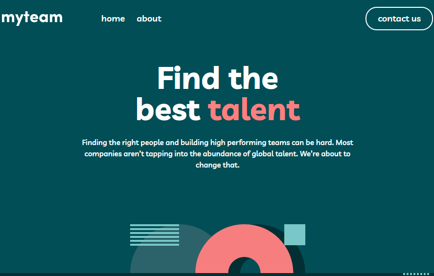

# myteam multi-page website

A three-page company website built for the [Frontend Mentor myteam challenge](https://www.frontendmentor.io/challenges/myteam-multipage-website-mxlEauvW), using HTML, CSS, and vanilla JavaScript.

## Overview

The project recreates the supplied designs across Home, About, and Contact pages. It focuses on responsive layouts, shared styles, DOM interaction, and client-side form validation without a framework.

**Status:** All three pages are implemented, including custom form validation and accessibility updates. Final polish and browser checks are in progress.

### Pages and interactions

- **Home:** Hero, feature list, customer testimonials, call to action, and shared footer.
- **About:** Company introduction, director cards with toggleable quotations and social links, named disclosure buttons connected to their panels, and client logos.
- **Contact:** Contact information and a form with Name, Email Address, Company Name, Title, and Message fields.
- **Shared navigation:** Named mobile menu controls with expanded-state updates, focus moved to the close button when opened, and focus returned to the opener when closed. Header and footer navigation have distinguishing labels.

The form shows "This field is required" for missing Name, Email Address, or Message values, and "Please use a valid email address" for a malformed email. Errors clear on a corrected submission, invalid fields receive `aria-invalid`, and focus moves to the first invalid control. Valid entries reveal a confirmation message, which clears before each subsequent validation attempt. There is no backend or message-delivery service connected.

### Repository

### Screenshot



[View the source on GitHub](https://github.com/JoeWebDevelopment/myteam-multi-page-website)

## Built with

- HTML with native form controls
- CSS custom properties for the color palette and font family
- Flexbox and CSS Grid
- Desktop-first styles with media queries for smaller screens
- Vanilla JavaScript and DOM event listeners
- The browser's Constraint Validation API
- Livvic from Google Fonts

## Running locally

Open `index.html` in a browser, or serve this directory with your preferred local static server, such as your editor's Live Server extension. No package installation or build step is required.

The font is loaded from Google Fonts and requires an internet connection. Images and SVG assets are stored locally in `assets/`.

## Project structure

```text
index.html       Home page
about.html       About page and director cards
contact.html     Contact page and form
style.css        Shared styles, page styles, and media queries
script.js        Shared menu behavior and director toggles
contactForm.js   Contact-only validation and feedback
assets/          Logos, portraits, icons, and decorative patterns
```

## Learning focus

This project has provided practice in:

- Translating Figma spacing into padding, gaps, and content widths rather than relying on fixed section heights.
- Choosing responsive changes based on content pressure and checking widths between the supplied designs.
- Understanding flex item sizing, including why an image can shrink despite a declared width.
- Reusing footer groupings across desktop, tablet, and mobile layouts.
- Attaching listeners to multiple controls with `querySelectorAll()` and `forEach()`.
- Using `event.currentTarget`, `closest()`, and scoped `querySelector()` calls to update the correct card.
- Keeping expanded states synchronized with visible content.
- Naming icon-only controls and connecting disclosure buttons to panels with unique IDs.
- Managing navigation focus and directing users to the first invalid form field.
- Distinguishing boolean validation properties from string-valued HTML attributes.
- Using `valueMissing` and `typeMismatch` to select field-specific error messages.
- Understanding block scope and why variables needed by multiple branches must be declared outside those branches.

## AI collaboration

ChatGPT/Codex was used as a tutor and code-review partner for layout reasoning, debugging, DOM events, and form validation. I did all feature implementations, codex was really only used for focused explanations and small examples rather than generated page implementations. I  did initially use codex to add the color custom properties and later draft this README. .

## Credits

Design and supplied visual assets: [Frontend Mentor](https://www.frontendmentor.io/).

The premium Figma design file is not included. Preserve the supplied `.gitignore` rules to avoid publishing it.
